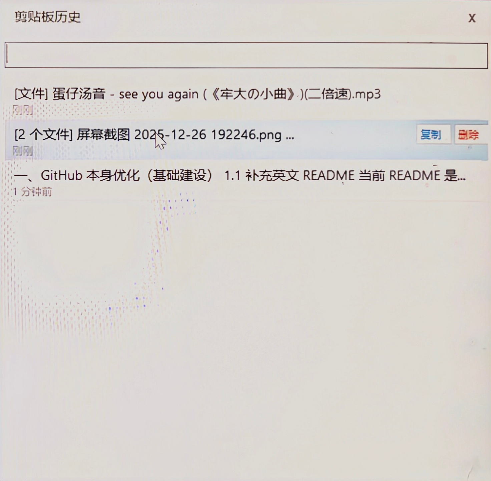

# ClipLite - 极致轻量剪贴板管理器


> [English](README_EN.md) | [中文](README.md)
[](https://dotnet.microsoft.com/download/dotnet-framework/net48)
[](LICENSE)



---

## 简介

ClipLite 是一款 **极致轻量化 + 秒开体验 + 无广告绿色便携** 的 Windows 剪贴板管理器。

旨在替代 Windows 原生剪贴板（Win+V），解决单次复制覆盖文本内容的核心痛点。基于 C# + WinForms + .NET Framework 4.8 构建，依赖系统自带运行时，即下即用。

| 指标     | 目标值    | 实际值     |
| -------- | -------- | -------- |
| EXE 体积 | < 1 MB   | **约 82 KB** |
| 后台内存 | 6~12 MB  | 实测约 8~10 MB（GC 稳定后） |
| 启动时间 | < 200 ms | **< 50 ms** |
| 热键唤起 | < 50 ms  | **即时**（窗口预创建） |
| CPU 占用 | 0%       | **0%**（消息驱动，无轮询） |

---

## 功能说明

### 1. 自动剪贴板监听

- 监听系统级剪贴板变化事件（`WM_CLIPBOARDUPDATE`），**零 CPU 轮询**
- 文本内容被复制时自动保存到历史列表
- 可在设置中开启复制提示：普通复制与从历史复用都会显示轻量浮层
- 最多保存 **500 条** 记录，超出时自动移除最旧条目

### 2. Hash 去重 + 防回写

- 每条文本通过 **SHA256 取前 16 位** 生成唯一指纹
- 相同内容不会被重复添加，仅移 **至列表顶部**（最近使用优先）
- 从 ClipLite 选中复制时自动跳过本次回写，产生死循环

### 3. 全局热键唤起

默认 `Ctrl + Shift + V`，可在「设置 → 全局快捷键」中改键或关闭。

| 操作 | 快捷键 |
| ---- | ---- |
| 打开/隐藏历史面板 | `Ctrl + Shift + V`（默认，可配置） |
| 关闭面板 | `Esc` |
| 选中下一条 | `↓` 方向键（聚焦列表框后） |
| 选中上一条 | `↑` 方向键 |
| 删除当前条目 | `Delete` |
| 置顶 / 取消置顶 | `Ctrl + P` |
| 切换到搜索框 | `↓`（搜索框聚焦时落入列表） |

- 热键通过 Win32 `RegisterHotKey` 注册，全局生效
- 历史面板在启动时 **预先创建**，热键按下时立即显示
- 改键后立即重新注册；被其他程序占用时托盘会弹出提示

### 4. 一键复用

- **单击** 条目即可复制（无需双击），或按回车键
- 自动复制该条目内容到剪贴板，可选用轻量浮层提示（不依赖系统通知中心）
- 提示位置可切换：**跟随复制内容** 或 **屏幕底部**；选择后立即生效并保存
- 复制后窗口保持打开，方便连续操作；按 `Esc` / 右上角 `✕` 关闭，切换到其他窗口时自动隐藏
- 鼠标悬停显示复制 / 删除按钮，右键菜单支持复制、置顶、删除
- 关闭面板后直接 `Ctrl + V` 粘贴

### 5. 全文搜索与筛选

- 面板顶部搜索框，**输入即搜**（实时过滤）
- 不区分大小写，匹配文本、文件路径、富文本预览和类型名
- 搜索命中片段会黄色高亮
- 支持按类型筛选：全部 / 文本 / 图片 / 文件 / 富文本 / HTML
- 搜索结果依然保留置顶排序

### 6. 缩略图与置顶管理

- 图片条目异步生成缩略图，列表直接预览，不阻塞界面
- 置顶条目显示 **橙色「置顶」标记**，并永久排在列表顶部
- 右键菜单或 `Ctrl + P` 置顶 / 取消置顶

### 7. 托盘后台驻留

- 启动后静默运行于系统托盘
- 托盘右键菜单：

| 菜单项 | 功能 |
| ------ | ---- |
| 显示历史 | 弹出历史面板 |
| 暂停监听 | 停止收集新的剪贴板内容 |
| 恢复监听 | 恢复收集 |
| 清空历史 | 确认后清除所有记录 |
| 设置 | 打开设置窗口（热键、抓取模式、排除程序、加密等） |
| 退出 | 完全退出程序 |

- 托盘图标 **双击** 也弹出历史面板
- 启动时显示轻量「ClipLite 已启动」提示，副标题显示打开历史的快捷键
- 图标为蓝色剪贴板，视觉辨识度高

### 8. 数据持久化

- 历史记录保存至 exe 同级目录下的 `cliplite_data/`
- `index.jsonl` 为 JSON Lines 索引，`assets/` 存放图片、RTF、HTML 等大对象
- 索引采用原子写入，并保留 `index.bak1~3.jsonl` 三份滚动备份
- 启用「加密存储」后索引以 AES-256 加密（文件头 `ENCR`）；assets 仍为独立文件
- 设置保存在 exe 同级的 `cliplite_settings.json`

---

## 项目结构

```
ClipLite/
├── .gitignore                      # Git 忽略规则
├── .gitattributes                  # Git 属性配置（行尾处理）
├── LICENSE                         # MIT 许可证
├── README.md                       # 本文件
├── README_EN.md                    # English README
│
├── Program.cs                      # 入口 + 应用编排
├── Models.cs                       # 数据模型 + 持久化
├── Services.cs                     # 剪贴板监听 + 热键管理
├── HistoryForm.cs                  # 历史面板 UI
├── Settings.cs                     # 设置模型
├── SettingsForm.cs                 # 设置窗口 UI
├── ThumbnailCache.cs               # 缩略图缓存（异步 + LRU）
├── UiTheme.cs                      # 配色、圆角面板、提示输入框
├── ToastForm.cs                    # 复制成功的应用内浮层提示
│
├── build.bat                       # 一键编译脚本
├── ClipLite.exe                    # 编译产物（约 82 KB）
└── cliplite_data/                  # 运行后自动生成的用户数据
```

---

## 三层架构

```
┌─────────────────────────────────────────────────────────┐
│                    交互层 (Presentation)                │
│  ┌──────────────────────────────────────────────────┐  │
│  │  HistoryForm.cs                                  │  │
│  │  - 无边框弹出面板 (阴影 + 置顶)                   │  │
│  │  - 搜索框 (实时过滤)                              │  │
│  │  - 自绘条目列表 (预览 + 时间 + 置顶标记)           │  │
│  │  - 键盘/鼠标事件处理                              │  │
│  └──────────────────────────────────────────────────┘  │
├─────────────────────────────────────────────────────────┤
│                    业务逻辑层 (Business Logic)          │
│  ┌──────────────────────────────────────────────────┐  │
│  │  Services.cs - ClipboardMonitor                  │  │
│  │  - Windows 消息窗口 (NativeWindow)               │  │
│  │  - AddClipboardFormatListener 监听               │  │
│  │  - 消息分发 (ClipboardChanged + WindowMessage)    │  │
│  │  - SHA256 Hash 去重                               │  │
│  └──────────────────────────────────────────────────┘  │
│  ┌──────────────────────────────────────────────────┐  │
│  │  Services.cs - HotkeyManager                    │  │
│  │  - RegisterHotKey / UnregisterHotKey            │  │
│  │  - Ctrl+Shift+V 热键绑定                         │  │
│  │  - WM_HOTKEY 消息处理                            │  │
│  └──────────────────────────────────────────────────┘  │
│  ┌──────────────────────────────────────────────────┐  │
│  │  Program.cs - ClipLiteContext                    │  │
│  │  - 应用生命周期管理                               │  │
│  │  - 事件编排 (监视器 → 热键 → 面板 → 存储)         │  │
│  │  - 托盘图标与右键菜单                             │  │
│  │  - 单例保护 (Mutex)                              │  │
│  └──────────────────────────────────────────────────┘  │
├─────────────────────────────────────────────────────────┤
│                    数据持久层 (Data Persistence)        │
│  ┌──────────────────────────────────────────────────┐  │
│  │  Models.cs - ClipboardEntry                     │  │
│  │  - 数据模型 (Id / Text / Timestamp / IsPinned)   │  │
│  │  - PreviewText / TimeDisplay 辅助属性            │  │
│  └──────────────────────────────────────────────────┘  │
│  ┌──────────────────────────────────────────────────┐  │
│  │  Models.cs - JsonStorage                        │  │
│  │  - 手动 JSON 序列化 (无外部依赖)                  │  │
│  │  - 最大容量 500 条自动修剪                       │  │
│  │  - 读: Deserialize (状态机解析)                  │  │
│  │  - 写: Serialize (StringBuilder)                │  │
│  └──────────────────────────────────────────────────┘  │
└─────────────────────────────────────────────────────────┘
```

---

## 技术栈

| 项目 | 选型 |
| ---- | ---- |
| 语言 | C# 5.0 |
| 框架 | .NET Framework 4.8 (Windows 自带) |
| UI | WinForms (System.Windows.Forms) |
| 图形 | System.Drawing |
| 编译器 | csc.exe (系统自带) |
| 存储 | JSON 文件 |
| 构建 | 单批处理命令 `build.bat` |

---

## 快速开始

### 方法一：直接运行

```
ClipLite\ClipLite.exe
```

启动后托盘出现蓝色图标，按 `Ctrl + Shift + V` 即可调出历史面板。

### 方法二：自行编译

```bat
cd ClipLite
build.bat
```

编译产物为 `ClipLite.exe`（约 82 KB）。

**环境要求：** Windows 10/11（自带 .NET Framework 4.8），无需任何额外安装。

---

## 常见问题

**Q：如何修改热键？**  
打开托盘菜单「设置 → 全局快捷键」，点击输入框后按下新组合键；按 `Backspace` 可关闭全局热键。

**Q：最多能存多少条历史？**  
默认 500 条。在 `Models.cs` 中修改 `MaxEntries` 常量可调整上限。

**Q：历史数据文件在哪？**

与 `ClipLite.exe` 同目录，位于 `cliplite_data/`（`index.jsonl` + `assets/`）。
删除整个 `cliplite_data` 文件夹即可清空历史记录（下次启动自动重建）。

**Q：如何开机自启？**  
在设置里勾选「开机自启动」，程序会自动写入当前用户的 `Run` 启动项，不需要手动放快捷方式。

注意：如果任务管理器「启动应用」里 ClipLite 被设为禁用，Windows 会单独记录一个 `StartupApproved` 禁用标记，此时 `Run` 项还在但开机不会运行。本版起程序在启用自启动时会自动清除该标记。

---

## 更新日志

### v1.1.1 — 2026-11-03

**修复**

- 开机自启动失效：Windows 把任务管理器里的禁用状态单独记在 `StartupApproved` 下，`Run` 项存在也不会在开机时执行。现在启用自启动时会一并清除该禁用标记
- `Run` 项路径改为带引号，避免 `ClipLite.exe` 放在含空格目录时启动到错误目标
- 中文 README 的自启动说明改为实际行为（原来写的是手动放启动文件夹）

### v1.1.0 — 2026-11-03

**新增**

- 应用内复制提示（`ToastForm`）：自绘圆角浮层与成功图标，淡入后自动消失，不抢焦点；不再依赖可能被 Windows 通知设置静默的托盘气泡
- 复制提示位置可切换：跟随复制内容（光标旁）或屏幕底部居中，设置中切换即时生效并自动保存
- 启动提示：程序就绪后显示「ClipLite 已启动」，副标题给出唤起历史的全局快捷键，热键注册失败时提示从托盘打开
- 历史面板重做：图片缩略图、单击复制、悬停复制 / 删除、右键置顶 / 删除、类型筛选、搜索命中高亮、空状态提示与完整键盘操作
- 设置窗口重做：全局热键捕获、复制提示开关与位置、分组卡片、存储占用统计，热键支持动态重注册
- 统一 `UiTheme` 主题：圆角面板与按钮、焦点描边、悬停状态
- 复制后历史窗口保持打开，并可拖动标题栏移动窗口

**修复**

- 加密历史丢失：加载时识别 `ENCR` 文件头并解密，密钥改为在读取前注入
- 解密失败进入保护模式：阻止写入覆盖，并跳过 assets 清理
- 自启动失效：`settings.json` 补写 `autoStart`，旧配置缺字段时保持默认
- 备份轮转异常：抽成 `RollBackups`，修复条件分支缺大括号导致的问题
- 保存指纹纳入加密状态，关闭加密后强制重写为明文
- 复制提示触发历史窗口失焦关闭：弹出前后短时抑制，用户主动切换窗口时仍按原逻辑隐藏
- 普通 `Ctrl+C` 与重复复制不显示提示的问题
- 重复图片分支未释放 `Image` 导致的泄漏
- 清理音频死代码与搜索路径的空引用

---

## License

MIT

