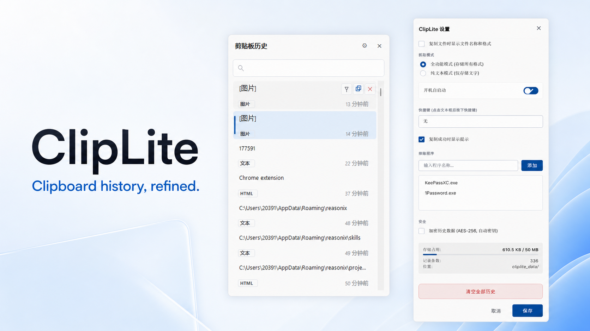
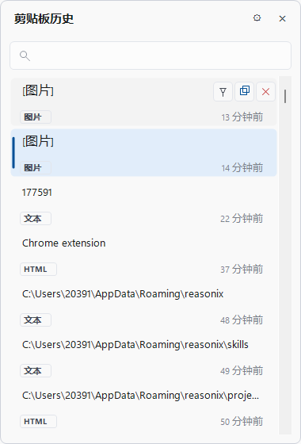
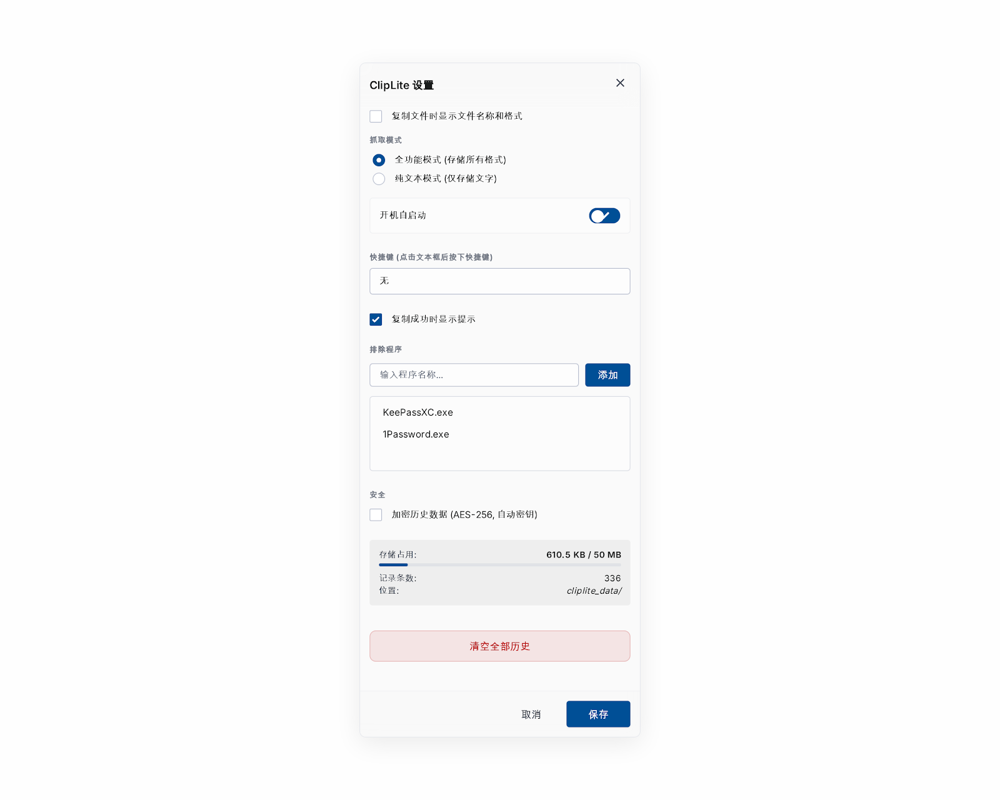

# ClipLite

> **English** | [简体中文](README.md)

<p align="center">
  
</p>

<p align="center">
  
  
  
  
</p>

ClipLite is a lightweight clipboard history utility built specifically for Windows. Its native WinForms interface combines instant access, multi-format history, full-text search, pinning, configurable hotkeys, and local-first storage without third-party UI libraries or an installer.

## Why ClipLite

- **Multi-format history:** text, rich text, HTML, images, and file lists in one timeline.
- **Fast workflow:** press `Ctrl + Shift + V`, select an entry, then paste anywhere.
- **Local first:** history, assets, and settings remain beside the executable.
- **Native and compact:** an approximately 90 KB single-file EXE with message-driven monitoring and no polling loop.
- **Privacy controls:** exclude password managers and other sensitive apps; optional AES-256 history encryption.

## Interface

<table>
  <tr>
    <td align="center"><strong>Clipboard history</strong></td>
    <td align="center"><strong>Settings</strong></td>
  </tr>
  <tr>
    <td align="center"></td>
    <td align="center"></td>
  </tr>
</table>

## Features

### History and search

- Event-driven clipboard monitoring through `WM_CLIPBOARDUPDATE`, with up to 500 entries.
- Duplicate content moves to the top instead of creating redundant records.
- Live search across text, paths, and HTML previews.
- Hover actions for pin, copy, and delete; pinned entries remain above regular history.

### Hotkeys and copy feedback

- Record a global hotkey directly in Settings and validate conflicts before saving.
- Transactional registration keeps the previous hotkey active when a new combination is unavailable.
- Optional non-activating success capsule at the bottom of the current screen.
- Clipboard writes are retried when busy and only report success after the write actually completes.

### Settings and storage

- Full-format or text-only capture mode.
- Auto-start, copy feedback, file details, and excluded apps in one settings window.
- JSONL index, separate asset storage, rolling backups, and orphan cleanup.
- 500-entry and 50 MB defaults, with live usage and entry counts in Settings.

## Quick start

### Download and run

1. Download `ClipLite.exe` from [Releases](https://github.com/2039108952x-lab/ClipLite/releases).
2. Run it; ClipLite stays available from the system tray.
3. Press `Ctrl + Shift + V` or use the tray menu to open history.

> Existing installations keep their locally configured hotkey. It can be changed or disabled in Settings.

### Build from source

```bat
git clone https://github.com/2039108952x-lab/ClipLite.git
cd ClipLite
build.bat
```

Requirements: Windows 10/11 and .NET Framework 4.8. The build script calls the system `csc.exe` directly, with no NuGet packages or Visual Studio project required.

## Keyboard controls

| Action | Control |
| --- | --- |
| Open / hide history | `Ctrl + Shift + V` by default; configurable |
| Search | Start typing after opening the panel |
| Navigate | `↑` / `↓` |
| Copy and close | `Enter` or click an entry |
| Delete | `Delete` or the hover delete button |
| Close | `Esc` |

## Data and privacy

All data is stored beside `ClipLite.exe`:

```text
cliplite_settings.json
cliplite_data/
├── index.jsonl
├── index.jsonl.bak1 ... bak3
└── assets/
```

ClipLite requires no account, does not upload clipboard content, and does not depend on a remote service. Add password managers or other sensitive applications to the excluded-app list when they should never be captured.

## Project structure

```text
Program.cs             Application lifecycle and event orchestration
Services.cs            Clipboard monitoring and transactional hotkey registration
Models.cs              Entry model, JSONL storage, and asset management
HistoryForm.cs         Clipboard history panel
SettingsForm.cs        Settings window
CopyFeedback.cs        Non-activating copy feedback capsule
UiTheme.cs             Colors, typography, rounded geometry, and DWM effects
build.bat              Single-command build script
```

## License

MIT
